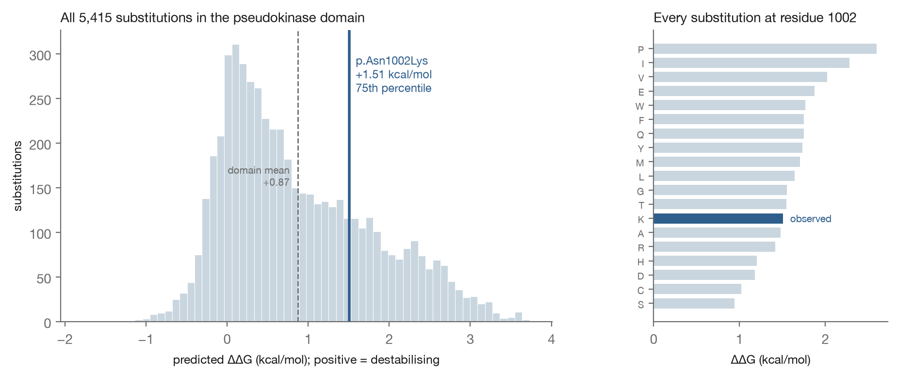
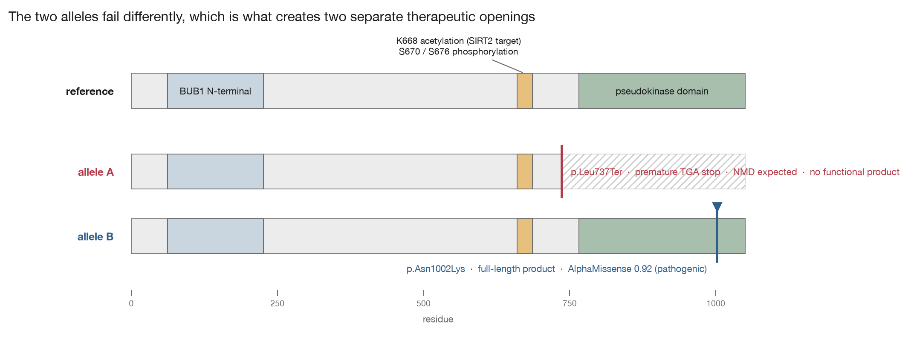
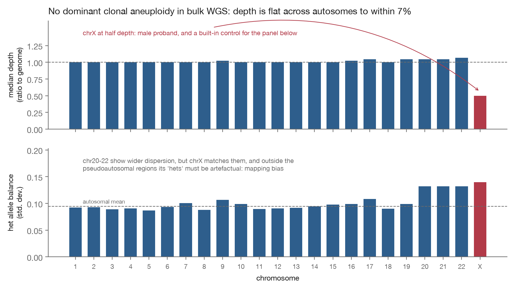

# Track 2: Allele-resolved drug repurposing hypotheses for BUB1B-related mosaic variegated aneuploidy

Participant: `michaldobiezynski`. Code and analysis: https://github.com/michaldobiezynski/mva-hackathon-2026

**Framing statement.** Everything below is a hypothesis for further investigation. Nothing here is evidence that any medicine works for this child or for MVA, and nothing here is medical advice; the one clinical item in this report (section 3.1) is an existing published surveillance guideline, reproduced so that it reaches the people who can act on it, not a recommendation of mine. Candidates are ordered by how directly the underlying evidence connects to this proband's specific genotype, and each states what would have to be shown before it could be taken seriously.

**A note to the family.** A plain-language summary of what this report says, without jargon, is in section 7.

---

## 1. Variant mechanism characterisation

### 1.1 The genotype

Track 1 identified, and the challenge's automated evaluation confirmed, a compound-heterozygous *BUB1B* genotype (GRCh38):

| Allele | Variant | Consequence | Read support | Evidence |
| --- | --- | --- | --- | --- |
| A | chr15:40209701 T>G | `NM_001211.6:c.2210T>G`, p.Leu737Ter (stop-gain) | AD 21,25 (DP 46), GQ 99, PASS | ClinVar VCV000533901, Pathogenic/Likely pathogenic for MVA1, multiple submitters, no conflicts; gnomAD AF 3.3e-5 |
| B | chr15:40220612 T>G | p.Asn1002Lys (missense) | AD 15,13 (DP 28), GQ 99, PASS | Absent from gnomAD; VEP MODERATE impact on ENST00000287598 |

Both calls sit at balanced allelic depth with maximal genotype quality. This is the canonical MVA1 architecture: affected individuals typically carry one missense allele together with one allele producing premature termination or absent transcript ([OMIM 257300](https://omim.org/entry/257300), MVA1 phenotype; gene entry [OMIM 602860](https://omim.org/entry/602860); [Ochiai et al. 2022](https://pmc.ncbi.nlm.nih.gov/articles/PMC9616775/)).

**Phase.** The two variants are **10,911 bp apart**, far beyond the reach of short-read or read-backed phasing, and no parental genotypes are available. Phase is therefore not merely unproven here, it is unrecoverable from the supplied data; trio or long-read sequencing would settle it. The trans configuration is inferred from the phenotype and the established MVA1 architecture, and every downstream argument treats it as an assumption.

### 1.2 What BubR1 does, and what these alleles do to it

BubR1 (1050 aa; [UniProt O60566](https://www.uniprot.org/uniprotkb/O60566)) is a core component of the spindle assembly checkpoint (SAC). Within the mitotic checkpoint complex it acts as a stoichiometric inhibitor of Cdc20, restraining the anaphase-promoting complex/cyclosome until every kinetochore is correctly attached ([Bolanos-Garcia review](https://www.ncbi.nlm.nih.gov/pmc/articles/PMC8066494/)). Below a threshold of function, chromosomes missegregate and the cell population accumulates the shifting, non-clonal aneuploidies that give MVA its name.

**Dosage dependence, and what the threshold data can and cannot support.** Bohers et al. titrated BUBR1 in human cells with shRNA, generating a residual-protein gradient (8.5%, 10%, 14%, 58%, 77% of normal). Premature chromatid separation (PCS) scaled continuously with the reduction, and aneuploidy was reported in cells with residual BUBR1 below 50% ([Bohers et al. 2008, *Hum Genet* 124:473](https://pubmed.ncbi.nlm.nih.gov/18932004/)).

Two qualifications matter, because a later argument depends on this number. First, the gradient has no data point between 14% and 58%, so the experiment localises a threshold only within that 44-point gap; "below 50%" is an interpolation, not a measured boundary. Second, PCS, the cytogenetic hallmark of MVA, was detected in **all** transduced cells including the 77% line, so not every disease-relevant phenotype is threshold-protected. The cells were also HeLa, already aneuploid.

What survives is the qualitative claim, which is enough: BubR1 function is dosage-dependent, and the therapeutic question is how much functional protein can be recovered rather than whether wild-type function can be restored. Section 1.4 works through what that means arithmetically for this particular genotype, and the answer is less comfortable than the threshold framing first suggests.

Mapping the alleles onto the domain structure (UniProt feature coordinates):

- **p.Leu737Ter** terminates translation at residue 737, upstream of the entire kinase-fold domain (766-1050). The premature stop lies far upstream of the final exon-exon junction of a 3,153-nt coding sequence, so nonsense-mediated decay of this transcript is expected. Treat this allele as producing no functional protein.
- **p.Asn1002Lys** substitutes a single residue inside the kinase-fold domain of an otherwise **full-length protein**.

### 1.3 What the missense allele is likely doing

**Human BubR1 is a pseudokinase.** Its kinase-fold domain binds nucleotide but delivers no phosphotransfer activity, and BUBR1 catalytic activity is dispensable for error-free chromosome segregation in human cells ([Suijkerbuijk et al. 2012](https://www.hubrecht.eu/app/uploads/2017/11/Kops_Research_2012_Suijkerbuijk_The-vertebrate-mitotic-checkpoint-protein-BUBR1-is-an-unusual-psuedokinase.pdf); reviewed in [Adventures of the undead at kinetochores](https://pmc.ncbi.nlm.nih.gov/articles/PMC8018434/)). So p.Asn1002Lys cannot be pathogenic by abolishing catalysis, because there is no catalysis to abolish. **Catalysis is dispensable; the domain is not.**

The domain was retained through vertebrate evolution for a structural reason: it **allosterically promotes phosphorylation of the KARD motif**, which recruits PP2A-B56 to the kinetochore and thereby governs checkpoint silencing and chromosome alignment ([Gama Braga et al., *Cell Reports* 2020](https://www.cell.com/cell-reports/fulltext/S2211-1247(20)31386-3)). KARD phosphorylation occurs at Ser670 (CDK1) and Ser676 (PLK1), both annotated in UniProt.

Four mechanisms are available to p.Asn1002Lys, and they do not all point the same way:

- **(i) Destabilisation**: lowering steady-state BubR1 and pushing total function below the dosage threshold.
- **(ii) Allosteric/scaffolding impairment**: degrading the pseudokinase domain's promotion of KARD phosphorylation and hence PP2A-B56 recruitment.
- **(iii) Loss or gain of a local site**: UniProt annotates Thr1008 as a PLK1 phosphosite, six residues away; and Asn→Lys introduces a *new lysine* into a protein whose abundance is governed by lysine acetylation and ubiquitination (section 2.0, point 3). Either is a local regulatory change rather than a global one.
- **(iv) Dominant-negative action**: a full-length product that still engages Cdc20 through its intact N-terminal regions could be incorporated into the mitotic checkpoint complex while failing to signal properly, poisoning the complex stoichiometrically.

Mechanism (i) is directly addressed by abundance-raising strategies, and it is the one the structural and thermodynamic evidence below supports. Mechanism (ii) is much less likely to benefit, though a partial rather than absolute scaffolding defect could be partly offset by mass action. **Mechanism (iv) inverts the sign of candidate 2 entirely: if the mutant product is dominant-negative, raising its abundance makes this child worse.** The computational evidence below favours (i), but it cannot exclude (ii) to (iv) operating alongside it, and mechanism (iv) is not something any structural prediction can rule out. That is why the first experiment must be a dose-response rather than a presence/absence measurement (section 2.3).

Splicing is excluded as a mechanism: `c.3006` lies in the final exon, 49 nt into it, with no downstream donor site to disrupt.

**Computational evidence that p.Asn1002Lys is damaging** (`eval/n1002k_predictors.json`, dbNSFP via MyVariant.info, hg38). The residue is highly conserved (phyloP 100-way 4.87; GERP++ RS 4.84). Predictors split 8 to 4 toward damaging:

| Verdict | Predictors |
| --- | --- |
| Damaging / pathogenic | **AlphaMissense: pathogenic (0.92, rankscore 0.84)**; ESM1b deleterious (-11.5); SIFT and SIFT4G 0.0; PolyPhen-2 HDIV 1.00 / HVAR 0.997; ClinPred 0.99; VEST4 0.89; CADD phred 24.5 |
| Tolerated / borderline | MetaSVM (T); PrimateAI (T); BayesDel (T); REVEL 0.472, just below the usual 0.5 threshold |

The disagreement is real and is reported rather than filtered: the ensemble methods that incorporate allele frequency are the ones calling tolerated, which is expected behaviour for an ultra-rare variant with no population signal to learn from, while the structure- and language-model-based predictors (AlphaMissense, ESM1b) call it pathogenic.

Under ACMG criteria this variant carries PM2 (absent from gnomAD), PP3 (computational support, now well-evidenced), and PP4 (phenotype highly specific for the gene). PM3 (in trans with a pathogenic variant) is **not** available because phase is unrecoverable here, which is what keeps the variant short of a confident Likely Pathogenic call; trio sequencing establishing trans would supply it. Formal classification is a clinical laboratory's responsibility, not this report's; the criteria are named so the gap is explicit.

**Structural context, which leans toward the druggable mechanism** (`eval/structural_context.py`, run against AlphaFold model AF-O60566-F1 v6; output in `eval/structural_context_output.txt`). Asn1002 sits in a confidently modelled region (pLDDT 91.1) and is **buried**: 136 heavy-atom neighbours within 10 A, the 76th percentile for this chain. Burying a charge is a classically destabilising substitution, and Asn→Lys does exactly that, introducing a longer, positively charged side chain into a packed environment. Mechanism (i), destabilisation, is therefore the better-supported of the four, and it is the one abundance-raising strategies can act on.

Three honest limits on that inference. It is a burial proxy, not a ΔΔG calculation, so it indicates a direction rather than a magnitude. It does not exclude mechanisms (ii) to (iv), and a destabilised protein can also scaffold poorly. And Asn1002 lies 12.3 A from the Thr1008 phosphosite, close in sequence but not in contact, which weakens the local-site variant of mechanism (iii) without eliminating it.

**The ΔΔG calculation, which quantifies it** (`REPRODUCE-DDG.md`; scan in `eval/ddg_ssm_kinase_domain.csv`, summarised by `eval/ddg_analysis.py`). ThermoMPNN ([Dieckhaus et al. 2024, *PNAS*](https://www.pnas.org/doi/10.1073/pnas.2314853121)) was run as a site-saturation scan over the extracted pseudokinase domain, 5,700 substitutions in total:

| Quantity | Value |
| --- | --- |
| **p.Asn1002Lys ΔΔG** | **+1.51 kcal/mol, destabilising** |
| Rank among the domain's 5,415 substitutions | 75th percentile |
| Mean ΔΔG at residue 1002 | +1.63, the 81st percentile of the domain's 285 sites |
| Domain-wide mean | +0.87 |

All figures exclude the 285 identity substitutions, which are not substitutions; including them shifts the variant's percentile by about one point.

The sign convention is established from the data rather than assumed: identity substitutions score exactly +0.0000, and X→Pro substitutions average +1.86 against an overall mean of +0.87, so positive values are destabilising.

Two features matter more than the number itself. First, **residue 1002 is a substitution-sensitive position** (81st percentile of sites), consistent with its conservation, its burial, and the sequence predictors calling the variant pathogenic. Second, and therapeutically, **the magnitude is moderate rather than catastrophic**: +1.5 kcal/mol describes a protein that still folds and is still made, at a reduced steady-state level, rather than one that is absent or grossly misfolded. That is precisely the regime in which raising abundance is worth attempting, since a severely destabilised product would leave nothing to stabilise.

*Figure 3. Left: the predicted ΔΔG of all 5,415 substitutions in the pseudokinase domain, with p.Asn1002Lys marked. Right: every substitution at residue 1002, showing that the site is broadly intolerant and that lysine sits mid-range within it rather than at either extreme. Positive values are destabilising, a convention derived from the scan itself (see text). Data: `eval/ddg_ssm_kinase_domain.csv`.*

Honest qualifications: p.Asn1002Lys is mid-range among possible substitutions at this site rather than the worst of them; ThermoMPNN was trained largely on small monomeric domains, so applying it to a domain excised from a large multi-domain protein is reasonable but not fully validated; and the input is a predicted structure. Full caveats in `REPRODUCE-DDG.md`.

**What remains unsettled.** Every line of evidence here is computational. Convergent prediction is not measurement, and the definitive test remains an immunoblot for steady-state BubR1 in patient-derived cells, which is step 1 of candidate 2's ladder.

**A regulatory convergence worth noting.** Lys668, the SIRT2 acetylation site that underpins candidate 2, lies immediately adjacent to the KARD phosphorylation sites Ser670 and Ser676. The NAD+/SIRT2 axis and the pseudokinase domain's allosteric function therefore act on the same short regulatory module, which raises the possibility that NAD+ repletion touches both protein stability and KARD-dependent scaffolding. This is a hypothesis suggested by the coordinates, not an established interaction, and it is testable alongside the experiments in section 2.3.

### 1.4 The two therapeutic openings this genotype creates

*Figure 1. BubR1 (1050 aa) with each allele's product shown separately. Allele A terminates at residue 737, upstream of the pseudokinase domain, and the transcript is expected to be degraded, so it yields no functional protein. Allele B is full length, carrying a substitution inside the pseudokinase domain. The KARD module (K668 acetylation, the SIRT2 target; S670/S676 phosphorylation) is retained on both. Domain coordinates from UniProt O60566; figure generated by `eval/make_figures.py`.*

Each allele fails differently, and each failure mode has its own class of intervention:

| Allele | Failure mode | Intervention class it exposes |
| --- | --- | --- |
| A: p.Leu737Ter | Premature stop codon; transcript likely degraded | **Nonsense readthrough** (section 2.2) |
| B: p.Asn1002Lys | Full-length protein, possibly destabilised | **Abundance/stability raising** (section 2.3) |

A child with two truncating alleles would need readthrough or gene replacement rather than stabilisation; a child with two missense alleles would have no readthrough target. Classifying each allele by the *product it yields* is what generates the candidate list, and it is the transferable idea in this report.

**The dosage arithmetic, and the measurement the whole argument turns on.** An obligate heterozygous carrier, one null allele plus one wild-type allele, sits at roughly 50% of normal BubR1 and is unaffected by MVA, though such carriers can show premature chromatid separation, which segregates as a dominant trait. So 50% of normal-quality protein is *sufficient*; it does not follow that the threshold sits *at* 50%, and section 1.2 is explicit that the underlying data localise it only somewhere between 14% and 58%.

Now apply that to this child. Allele A contributes nothing. **The ceiling is firm**: any intervention acting only on allele B is bounded by one allele's worth of output, roughly 50% of normal abundance, and reaching even that would require restoring the mutant product to full per-allele abundance *and* full function, which contradicts the premise that the variant is pathogenic. Stabilisation cannot overshoot the carrier-equivalent level; it approaches from below, with protein of impaired quality.

**Whether that ceiling binds depends on where the threshold actually sits, and nobody has measured it.** If the threshold lies near the carrier level, neither candidate suffices alone and only their combination is coherent, one recovering quantity from the silent allele (though the readthrough product is substituted at residue 737, so its contribution to *functional* protein could be anywhere from substantial to zero), the other recovering quality and abundance from the expressed one. If instead the threshold lies nearer the lower end of the permitted window, stabilisation of allele B alone could clear it comfortably and no combination is needed.

Locating that threshold is therefore not a detail but the measurement on which the entire dosage argument rests, and it is a tractable experiment in patient-derived cells: titrate BubR1 and find where segregation fidelity breaks. Any proposal that assumes a 50% threshold without measuring it, including the first version of this one, is asserting more than the data support.

### 1.5 Downstream consequences that create further targets

1. **Proteostasis and mitochondrial failure.** In a *Drosophila* neural-stem-cell model of SAC depletion built explicitly as an MVA model, complex aneuploidy compromises stemness through proteostasis failure and mitochondrial dysfunction, and **restoring mitochondrial function recovers brain size** ([González-Blanco et al. 2026, *Nat Commun*](https://www.nature.com/articles/s41467-026-70521-0)).
2. **Senescence burden.** BubR1-insufficient mice develop progeroid phenotypes driven substantially by p16^Ink4a^-positive senescent cells, and clearing those cells delays onset and progression ([Baker et al. 2011, *Nature* 479:232](https://www.nature.com/articles/nature10600)). Two features described in this child, low muscle mass and failure to thrive, overlap with features seen in that model, which is why its findings are relevant here.
3. **Cancer predisposition.** This child's rhabdomyosarcoma is consistent with the malignancy risk specific to the BUB1B subtype, unlike the CEP57 subtype where malignancy is typically absent. Each candidate below is assessed for its predicted direction of effect on cancer risk where the evidence allows, and marked as unresolved where it does not.

### 1.6 What the proband's own data can and cannot show

I attempted to quantify mosaic aneuploidy directly from the supplied bulk WGS VCF, using per-chromosome median depth and dispersion of heterozygous allele balance (`eval/mosaicism_scan.tsv`, chromosome-level aggregates only; code in the repository).

*Figure 2. Bulk WGS shows no dominant clonal aneuploidy. Top: per-chromosome median depth relative to the genome median. Bottom: dispersion of heterozygous allele balance. chrX serves as an internal control in both panels: at half depth it confirms a male proband, and its heterozygous calls, which are necessarily artefactual, show the same wider dispersion as chr20-22, which is why mapping bias rather than mosaicism is the parsimonious reading of those chromosomes. Data: `eval/mosaicism_scan.tsv`.*

Median depth is flat at 44x across chr1-18 (ratios 1.00), with chrX at 0.50 as expected for a male proband. No dominant clonal aneuploidy is present. Chromosomes 20-22 show wider allele-balance dispersion (sd ~0.13 vs ~0.09) and 4.5-7% higher depth, but the male chrX "heterozygous" calls, which are necessarily artefactual, carry the same signature, so short-chromosome GC/mapping bias is the more parsimonious explanation.

Three caveats:

- **This method is crude.** It is unphased and detects only substantial clonal imbalance. The field-standard approach is a phased-BAF-plus-coverage hidden Markov model (MoChA). Because MVA aneuploidy is non-clonal and MoChA is built to detect clonal events, it would most likely return the same negative more rigorously rather than a different answer.
- **The negative is specific, not general.** Random per-cell whole-chromosome events in different directions do largely cancel in bulk data; that is not the same as saying bulk WGS cannot detect mosaicism at all, which would be false.
- **Tissue matters.** MVA mosaicism is classically assayed on cultured cells, and PHA-stimulated lymphocyte culture selects against aneuploid cells, so blood may be among the least informative tissues available.

Mosaic fraction is the natural biomarker for whether any intervention in section 2 is working, and it cannot be read from these data. That gap shapes section 3.2.

---

## 2. Repurposing candidates

### 2.0 How this candidate list was generated

The first question in any repurposing exercise is whether the target can simply be drugged directly. A systematic query of Open Targets for *BUB1B* (`eval/target_druggability.py`, output in `eval/opentargets_bub1b.json`) answers it:

| Query | Result |
| --- | --- |
| Drugs and clinical candidates against BUB1B | **0** |
| High-quality chemical probes | **0** |
| Small-molecule tractability buckets met | "High-Quality Ligand", "Druggable Family" |
| Protein-degrader tractability buckets met | "Literature", "UniProt Ubiquitination", "Database Ubiquitination" |

Three things follow, and they determine the entire structure of this section.

1. **No direct pharmacology exists.** Not one drug or clinical candidate targets BubR1, and there is not even a high-quality chemical probe. A candidate list for this child therefore cannot be built from direct inhibition or activation; it has to come from the lesion classes each allele creates (section 1.4) and from downstream pathway rescue.
2. **The protein is not intrinsically undruggable.** It sits in a druggable family with high-quality ligands recorded, so the absence of drugs reflects a lack of therapeutic motive rather than a closed door. That is a meaningful distinction for a rare disease, where motive is exactly what has been missing.
3. **The degrader-tractability evidence points the wrong way, and is useful anyway.** BubR1 qualifies on protein-degrader buckets because it is well documented as ubiquitinated. Degradation lowers protein, which is the opposite of what this child needs, but the same evidence independently confirms that **BubR1 abundance is controlled by ubiquitin-mediated degradation**, which is precisely the axis that acetylation at Lys668 and SIRT2 deacetylation regulate. A druggability database built for a different purpose corroborates the mechanism underlying candidate 2.

The candidates below are therefore indirect by necessity, not by preference, and the search that establishes this is reproducible with one command.

### 2.1 Candidate decision table

| # | Candidate | Target allele / mechanism | Evidence tier | Regulatory tractability | Paediatric safety | Predicted effect on cancer risk | Cheapest falsification |
| --- | --- | --- | --- | --- | --- | --- | --- |
| 1 | Ataluren; ELX-02; gentamicin (readthrough) | Allele A: TGA premature stop | Human trials in other nonsense diseases; none in MVA | Ataluren contested; ELX-02 investigational; gentamicin approved but toxic | Ataluren used in children (DMD); aminoglycoside oto/nephrotoxicity a serious concern | Unresolved: favourable if functional BubR1 rises, but the readthrough product is substituted at residue 737 and its function is unknown. Does not carry candidate 2's NAD+ tumour-metabolism liability | Allele-specific expression, then readthrough reporter + BubR1 immunoblot in patient cells |
| 2 | NMN; nicotinamide riboside; nicotinamide | Allele B: SIRT2-dependent BubR1 stabilisation | Mouse in vivo BubR1 increase; human RCTs only for unrelated endpoints | Nicotinamide widely available; NMN/NR are supplements | Extensive human exposure to nicotinamide; far less for NMN/NR, which rank first on mechanism | **Unresolved, and the first-order safety question**: Baker 2013 supports raising BubR1 itself, but NAD+ precursors act pleiotropically on tumour metabolism (section 2.3) | BubR1 immunoblot ± NAD+ precursor in patient cells |
| 3 | Rapamycin (TOR axis); N-acetylcysteine or mitochondria-targeted antioxidants (ROS axis) | Downstream of aneuploidy in an MVA model | Genetic rescue in *Drosophila* MVA model | Both approved or widely available | Rapamycin has paediatric use in other indications | Plausibly favourable for rapamycin (mTOR inhibitors are used in oncology); unresolved for antioxidants | Mitochondrial function assay in patient cells |
| 4 | Dasatinib + quercetin (senolytics) | Downstream senescence burden | Mouse BubR1 model; human trials in other indications | Dasatinib approved (oncology) | Serious concerns in a child with a malignancy history | Unresolved | Measure p16/SASP burden first |
| 5 | **Avoid**: Mps1/TTK, Aurora B inhibitors | Further SAC weakening | Mechanistic | n/a | n/a | Adverse | n/a |

### 2.2 Allele A: nonsense readthrough

**The specific fact.** `c.2210T>G` changes codon 737 from **TTA to TGA**: of the six leucine codons, TTA is the only one that a T>G substitution at codon position 2 converts into a stop, so the identity of the premature stop codon is determined unambiguously by the variant itself (`eval/stop_codon_identity.py`). The premature stop is therefore **TGA (UGA in mRNA)**.

**Why that matters, and why it is only half the determinant.** UGA is the leakiest of the three stop codons, and ataluren promotes dose-dependent readthrough of all three **with highest efficiency at UGA** ([Ataluren review](https://www.mdpi.com/1424-8247/14/8/785); [mechanism study](https://pubmed.ncbi.nlm.nih.gov/24483936/)). On codon identity alone, this allele is in the favourable class.

Codon identity is not sufficient, however: readthrough efficiency is set by the stop codon **together with its 3' context**, and the +4 nucleotide is a first-order term. Reading the actual coding sequence of ENST00000287598 settles what that context is here. The variant creates TGA at c.2209-2211, and **c.2212 is A**, giving the tetranucleotide **UGA-A** and the downstream hexanucleotide AGUGCC.

That is the unfavourable end of the range. Termination efficiency at the +4 position follows roughly A = G >> U = C, so an A at +4 makes termination *more* efficient and readthrough *less*; the permissive contexts are UGA-C and UGA-U, and the human genes with efficient natural readthrough carry UGA-CUAG-type contexts ([Loughran et al. 2014, *NAR* 42:8928](https://pubmed.ncbi.nlm.nih.gov/25013167/); [readthrough motif analysis](https://www.nature.com/articles/s41467-024-46703-z)). UGA-AGUGCC matches no permissive motif.

The honest position is therefore mixed rather than favourable: the codon is the right one, the context is not, and the two determinants point in opposite directions. This does not eliminate the candidate, because pharmacological readthrough agents do not simply recapitulate natural context effects, but it does mean step 2 of the ladder below is the decisive experiment rather than a formality, and it removes any claim that this allele is unusually amenable on sequence grounds alone.

**What readthrough would actually produce.** Not wild-type protein. Suppression proceeds by near-cognate tRNA misreading, which at UGA inserts tryptophan, arginine or cysteine in proportions that vary with the readthrough-inducing agent ([Roy et al. 2015, *PNAS* 112:3038](https://www.pnas.org/doi/10.1073/pnas.1424127112); [Blanchet et al. 2014, *NAR* 42:10061](https://academic.oup.com/nar/article/42/15/10061/2435234)); both of those studies are in yeast, so the proportions in human cells are an additional unknown. The product is therefore **full-length BubR1 carrying a substitution at residue 737**. Residue 737 lies between the KARD motif and the kinase-fold domain, in a region carrying no annotated functional feature. Rather than leave that as absence of evidence, the same predictor pipeline used for p.Asn1002Lys was run at this position:

- **The residue is poorly conserved**: phyloP 100-way 0.35, against 4.87 for Asn1002 in the same protein. Conservation is a property of the position, so this applies whichever residue readthrough inserts.
- **L737R is predicted benign** (AlphaMissense 0.07-0.08 benign; PolyPhen-2 benign; CADD 18.7; SIFT dissenting as deleterious). Trp and Cys substitutions require two nucleotide changes from the reference TTA codon and so have no dbNSFP record, and cannot be scored this way.

The readthrough product is therefore more likely tolerated than not at this position on sequence grounds, which is a genuine point in candidate 1's favour and partly offsets the unfavourable stop-codon context above.

One apparent caveat from the structural pass resolves on inspection. Leu737 also scores as buried in the AlphaFold model (80th percentile), which would ordinarily argue against tolerating a bulky or charged substitution. But **82 of its 128 neighbouring atoms come from outside the pseudokinase domain**, whereas Asn1002 draws 129 of 129 from within it. Leu737's apparent burial is therefore a property of how the model packs domains against one another, the least reliable aspect of a multi-domain AlphaFold prediction, rather than of a genuine local environment. The same measurement is why no ΔΔG is reported for this site: the calculation would be dominated by model artefact.

The sequence-based benign predictions for the readthrough product consequently stand without a real structural counterweight. Step 3 of the ladder still settles it by measurement.

**Candidate agents.** Ataluren (oral, extensive paediatric exposure in Duchenne muscular dystrophy); ELX-02 (investigational aminoglycoside analogue); gentamicin (approved but with real oto- and nephrotoxicity).

**The case against.** Ataluren's regulatory position is contested and its efficacy in DMD disputed; aminoglycoside toxicity is unacceptable for chronic paediatric use; readthrough efficiency is typically low single-digit percentages; and readthrough is inseparable from the NMD question, since a transcript degraded before translation cannot be read through, which is why NMD-inhibition combination approaches exist.

**Falsification ladder:**
1. Is allele A transcript present at all in patient cells (allele-specific expression by RNA-seq or allele-specific qPCR)? If NMD has removed it, readthrough alone cannot work, and the question becomes whether NMD inhibition plus readthrough is viable.
2. Does readthrough agent exposure produce detectable full-length BubR1 in patient-derived cells?
3. **Does the readthrough product, carrying Trp/Cys/Arg at position 737, retain checkpoint function?** A substituted full-length protein that cannot work is not a therapeutic gain.
4. Does any functional increase reduce missegregation or aneuploidy fraction?

### 2.3 Allele B: NAD+ repletion to stabilise the full-length product

**Mechanism link.** BubR1 abundance is regulated by acetylation at Lys668: CBP-mediated acetylation primes degradation, and the NAD+-dependent deacetylase SIRT2 opposes it. Overexpressing SIRT2 or treating mice with the NAD+ precursor NMN **increases BubR1 abundance in vivo**, and SIRT2 overexpression extends median lifespan in BubR1-hypomorphic mice ([North et al. 2014, *EMBO J* 33:1438](https://www.ncbi.nlm.nih.gov/pmc/articles/PMC4194088/)).

Two boundaries on that evidence: the lifespan rescue came from the SIRT2 **transgene**, not from NMN, so NMN has been shown to raise the protein but never to rescue a BubR1-deficiency phenotype; and the BubR1-hypomorphic mouse makes a reduced quantity of **wild-type** protein, so it models the disease's quantitative axis, globally reduced dosage of normal-quality protein, rather than the consequence of either of this child's alleles individually.

**What the supporting mouse evidence does and does not establish.** Sustained BubR1 overexpression in mice attenuates aneuploidy, reduces chromosomal instability and tumorigenesis **even in the presence of oncogenic Ras**, and extends lifespan ([Baker et al. 2013, *Nat Cell Biol* 15:96](https://www.nature.com/articles/ncb2643)).

That result is genuinely encouraging about the *direction* of raising BubR1, and it is important not to overstate it. Baker 2013 overexpresses **wild-type** BubR1 in mice carrying two intact endogenous alleles. It does not test whether raising the abundance of a structurally altered BubR1 helps, which is what this child's genotype would require; under mechanism (ii) of section 1.3, more mutant protein is simply more non-functional protein. Nor does a Ras-driven carcinogenesis model speak directly to a germline checkpoint-deficiency syndrome whose tumour spectrum is embryonal and early-onset. The claim this report makes is therefore the narrow one: raising wild-type BubR1 is protective in an otherwise normal mouse.

**Convergence with the MVA model literature.** Restoring mitochondrial function rescues the MVA phenotype in the *Drosophila* model above, and NAD+ repletion improves mitochondrial function; two lines of evidence point the same way by different routes. The Lys668/KARD adjacency in section 1.3 is a third, more speculative convergence within the protein itself.

**A divergence, in the other direction, between two of this report's own candidates.** The NAMPT-NAD+ axis drives the pro-inflammatory senescence-associated secretory phenotype independently of senescence growth arrest, which is why that work closes by recommending that dietary NAD+ augmentation be administered with precision ([Nacarelli et al. 2019, *Nat Cell Biol* 21:397](https://pubmed.ncbi.nlm.nih.gov/30778219/)). Candidate 2 raises NAD+; candidate 4 (section 2.5) exists to *reduce* senescent-cell burden and its inflammatory output in a child whose burden is presumed elevated. The two candidates are therefore in partial opposition, and cannot be pursued naively in combination. SASP measurement belongs in candidate 2's evaluation, not only candidate 4's.

**Candidate agents, and a mechanistic inversion that reorders them.** The obvious first pick is nicotinamide: widely available, and the only NAD+ precursor with phase 3 RCT evidence on an oncology-prevention endpoint. On this mechanism it is the *worst* of the three.

Nicotinamide is the physiological product-inhibitor of sirtuins, acting by base exchange on the covalent intermediate; at saturating nicotinamide the great majority of that intermediate reverts to the **acetylated** protein instead of being deacetylated ([Sauve & Schramm 2003, *Biochemistry* 42:9249](https://pubmed.ncbi.nlm.nih.gov/12899610/)). It therefore acts in both directions on the Lys668 axis: raising NAD+ favours SIRT2, while directly inhibiting SIRT2 favours the acetylated, degradation-primed state of BubR1. North et al. used NMN rather than nicotinamide, and this is a plausible reason why.

Ranking on mechanism rather than on availability: **NMN** (the agent with the direct BubR1 evidence), then nicotinamide riboside, then nicotinamide, which is retained only for its human safety pedigree. NMN and NR are marketed as supplements rather than approved medicines, a regulatory obstacle rather than a biological one. This ordering is itself testable, and cheaply: a head-to-head immunoblot of NMN and NR against nicotinamide in patient cells should show nicotinamide underperforming or reversing the effect. If it does not, the mechanism as described here is wrong.

**The human trial evidence, in full.** In ONTRAC ([NEJM 2015](https://www.nejm.org/doi/full/10.1056/NEJMoa1506197)), 500 mg twice daily reduced new non-melanoma skin cancers by 23% (P=0.02) in 386 immunocompetent high-risk patients, with no notable safety signal and no benefit persisting after discontinuation. The replication attempt failed: in solid-organ transplant recipients ([NEJM 2023](https://www.nejm.org/doi/full/10.1056/NEJMoa2203086)) nicotinamide did not reduce keratinocyte cancers, though that trial stopped early at 158 participants for poor recruitment and is underpowered rather than decisively negative. These trials concern a different disease mechanism and endpoint; they are cited for tolerability and precedent, not as evidence of benefit here.

**The strongest objection to this candidate, which is a safety objection.** Baker 2013 shows that raising *BubR1* protects against tumorigenesis. It does not show that raising *NAD+* is safe in a child with a cancer predisposition, and those are different claims: NAD+ precursors act on far more than BubR1. The opposing evidence is substantial and must be stated plainly.

- **This child's own tumour type is a published NAMPT dependency.** In ten molecularly diverse rhabdomyosarcoma lines, NAMPT inhibition depleted NAD+ and blocked growth at or below 1 nmol/L, causing ATP collapse and necrotic death, and produced **complete tumour regressions in orthotopic xenografts** ([McKay-Corkum et al. 2023, *Clin Cancer Res* 29:4479](https://pubmed.ncbi.nlm.nih.gov/37616468/)). This is not the generic observation that cancer cells upregulate NAMPT, though that is also true and underpins NAD-depletion as an anticancer strategy ([review](https://www.ncbi.nlm.nih.gov/pmc/articles/PMC10889166/)). It is the specific observation that in rhabdomyosarcoma, the tumour this child has already had, starving cells of NAD+ is curative in vivo. Candidate 2 proposes the opposite intervention.
- The evidence is genuinely mixed rather than uniformly adverse: NR supplementation suppressed hepatocellular cancer progression, reduced allograft tumour size and lung metastasis, and extended survival in mice ([Nutrients 2023;15:1447](https://www.ncbi.nlm.nih.gov/pmc/articles/PMC10055624/)). Direction appears context- and tumour-type-dependent.
- There is a concrete drug-interaction hazard independent of that debate: **exogenous NAD+ precursors abrogate the cell death induced by NAMPT inhibitors**, including NMN specifically, which rescues NAMPT-inhibitor-induced death in Ewing sarcoma cells ([Gibson et al. 2020, *Oncogenesis* 9:80](https://pubmed.ncbi.nlm.nih.gov/32908120/); see also [Cancers 2023](https://www.ncbi.nlm.nih.gov/pmc/articles/PMC9913462/) for nicotinaldehyde). Were this child ever treated with an NAD-lowering agent, concurrent precursor supplementation could antagonise it.

For a child with a rhabdomyosarcoma history and a syndromic cancer predisposition, this is not a caveat to be handled after efficacy is established; it is a gating question that ranks alongside step 1 below. A tumour-metabolism assessment specific to this child's risk profile, by clinicians who know the case, would have to precede any consideration of chronic NAD+ precursor exposure. Candidate 1 (readthrough) does not carry this particular liability, which is a further reason it is presented first.

**Falsification ladder, gating question first:**
1. **Titrate BubR1 abundance and read segregation fidelity across the range** in patient-derived cells (varying precursor dose, or mutant construct dose in a controlled background), alongside an immunoblot for steady-state protein. A presence/absence measurement cannot discriminate the four mechanisms of section 1.3; a dose-response can. The decision rule: fidelity improving with abundance supports mechanism (i) and the candidate proceeds; a flat response supports (ii) or (iii) and the candidate is unlikely to help; **fidelity degrading as abundance rises supports (iv), the dominant-negative case, and stops this candidate outright.** This is the gating experiment, and it must precede everything below.
2. Does NAD+ precursor exposure raise BubR1 protein levels in those cells?
3. Does any increase reduce missegregation rates or aneuploidy fraction?
4. **Does NAD+ precursor exposure increase the proliferation or survival of rhabdomyosarcoma lines, or of any patient-derived tumour material?** This is a stopping condition, not a formality: measurable tumour-cell benefit from the precursor ends this candidate for this child regardless of what steps 1-3 showed.
5. Does the intervention worsen SASP/IL-6 output (see the contradiction with candidate 4 below)? A favourable BubR1 immunoblot alongside a worsened inflammatory secretome is a failed result, not a mixed one.
6. Only then: paediatric dosing and safety, assessed by clinicians who know this child's oncological risk.

### 2.4 Mitochondrial and proteostasis support

The MVA-specific *Drosophila* work rescued the phenotype through autophagy activation, ROS scavenging, and restoration of mitochondrial proteostasis. Those interventions were genetic, so their pharmacological translation is unclaimed ground: rapamycin for the TOR axis, N-acetylcysteine or mitochondria-targeted antioxidants for the ROS axis. This is the least mature candidate class here. It is included because it rests on the only intervention evidence generated in an explicitly MVA-framed model, and because it converges with candidate 2. On cancer-risk direction, mTOR inhibition is already used therapeutically in oncology, so rapamycin's direction is plausibly favourable; the antioxidant arm is unresolved and would need its own assessment, since antioxidants have shown context-dependent effects on tumour progression.

### 2.5 Senolytics for the downstream senescence burden

The senescent-cell clearance experiments that founded the senolytics field were performed in BubR1-hypomorphic mice, so dasatinib plus quercetin is an obvious candidate for a BUB1B disorder, and obviousness is not an argument against correctness. It remains secondary because it targets a downstream consequence rather than the checkpoint defect; because the mouse evidence concerns ageing phenotypes rather than the malignancy risk and growth failure that dominate this child's presentation; and because dasatinib in a child with a malignancy history raises safety questions beyond what this analysis can weigh. Cancer-risk direction is unresolved. The defensible near-term step is measuring senescent-cell burden (p16 expression, SASP markers) in patient-derived cells to establish whether the burden this proposal targets is elevated at all.

### 2.6 A negative recommendation: avoid further checkpoint weakening

Mps1/TTK and Aurora B inhibitors are in oncology development precisely because they abrogate the spindle assembly checkpoint. In a patient whose checkpoint is already below threshold, they are mechanistically contraindicated outside a deliberately tumour-directed context under specialist oversight.

---

## 3. Potential impact

### 3.1 The most immediately useful output: existing surveillance guidance

Confirming a BUB1B-related MVA diagnosis has a concrete clinical implication that already exists in published guidance and requires no new research: **Wilms tumour surveillance by renal ultrasonography every three to four months until age five** is recommended for individuals with cytogenetically confirmed MVA and/or BUB1B mutations ([SIOP-Europe Host Genome Working Group and SIOP Renal Tumour Study Group consensus recommendations, *Eur J Cancer* 2021;153:51](https://pubmed.ncbi.nlm.nih.gov/34134020/); see also [Orphanet](https://www.orpha.net/en/disease/detail/1052)), against a documented background of high malignancy incidence in the BUB1B subtype, including Wilms tumour, rhabdomyosarcoma and leukaemia, typically presenting in early childhood.

This is not a recommendation of mine, and it is for the child's clinical team to apply or to have already applied. It is reproduced here because a report that establishes the genotype and stops short of noting the surveillance implication would have withheld the most immediately actionable consequence of its own finding.

### 3.2 Research impact

- **For this child**: two candidate intervention classes aimed at the causal mechanism rather than symptom management, each with a cheap first experiment that can rule it out before anyone's expectations are raised.
- **For others with MVA**: the allele-classification step generalises. Any patient retaining a full-length allele is a candidate for stabilisation; any patient with a premature stop codon, particularly UGA in a permissive 3' context, is a candidate for readthrough; patients carrying one missense plus one truncating allele, the architecture the MVA1 literature describes as typical, are candidates for both at once.
- **A measurement gap worth closing regardless**: mosaic fraction is the natural biomarker for disease burden and for any intervention, and section 1.6 shows the supplied bulk WGS cannot deliver it. Establishing single-cell or cytogenetic mosaicism measurement for this child is a prerequisite for evaluating any of this, and is useful even if every candidate above fails.

---

## 4. Innovation

To the best of a literature search conducted 26/08/2026 across PubMed, Europe PMC and general web search, no publication proposes NAD+ repletion, senolytics, or nonsense readthrough for mosaic variegated aneuploidy. Three things here are, as far as that search reaches, new:

1. **Allele-resolved candidate generation.** The two alleles are treated as separate therapeutic problems with separate solution classes, rather than the genotype being treated as one lesion. This is what produces the readthrough candidate, which a gene-level analysis cannot see.
2. **Stop-codon identity *and 3' context* as therapeutic determinants.** Deriving the premature codon (TGA) and its tetranucleotide context (UGA-A) from the coding sequence, then scoring both against the readthrough-efficiency literature, turns a routine annotation into candidate selection, and in this case into a partly unfavourable answer that a codon-only analysis would have missed.
3. **Reasoning from the pseudokinase literature to the intervention.** Because BubR1's catalytic activity is dispensable, the missense allele cannot act by abolishing catalysis, which redirects the question to stability, allosteric scaffolding, local-site change or dominant-negative action. Which of those holds determines whether raising the protein helps or harms, and it is why the lead experiment is a dose-response rather than a measurement of abundance alone.

The work builds on and converges with [González-Blanco et al. 2026](https://www.nature.com/articles/s41467-026-70521-0), the intervention study in an MVA-framed model whose mitochondrial rescue supports candidate 3 directly and candidate 2 indirectly.

The method is reusable: identify the causal variant, classify each allele by the product it yields, ask what is known to raise or stabilise that specific protein or to rescue that specific lesion class, and filter by whether the patient's own allelic architecture leaves anything for the intervention to act on.

---

## 5. Scalability

The analysis runs on a laptop from a VCF plus the clinical phenotype terms, using public resources only (ClinVar, gnomAD, Ensembl VEP, UniProt, MyVariant.info), with code in the repository. The phenotype terms drove gene prioritisation in Track 1, which is what made the four-gene targeted pass the correct first move; the pipeline below inherits that ordering.

The generalisable pattern:

1. Identify the causal variant(s), using phenotype terms to prioritise candidate genes.
2. **Classify each allele by the product it yields**: no protein (premature stop, with the stop codon identity recorded), full-length but altered, or absent transcript.
3. Establish whether the disorder is dosage-dependent with a threshold, since that determines whether partial rescue is meaningful.
4. Map each allele's failure mode to intervention classes: readthrough for premature stops; abundance or stability raising for full-length products; pathway rescue for downstream consequences.
5. **Filter by allelic architecture**: stabilisation needs a stabilisable product, readthrough needs a premature stop. This step eliminates candidates that otherwise look attractive.
6. Identify the biomarker for the mechanism and check whether available data can measure it.
7. Rank by regulatory tractability and state the cheapest falsifying experiment for each.

Steps 2-5 apply to any dosage-dependent loss-of-function disorder, a large class. Step 6 is the one most often skipped, and it is what makes the difference between a plausible proposal and a testable one.

The pattern has been run end to end on a second, unrelated case (section 8) using the same scripts without modification. Two cases is a demonstration, not a validation; what it establishes is that the steps are executable and that they discriminate, since the second case returns materially different answers at two of them.

---

## 6. Limitations

- The functional consequence of p.Asn1002Lys is **predicted, not measured**. Three independent computational lines now converge on destabilisation (sequence predictors, burial, and a +1.51 kcal/mol ΔΔG), but convergent prediction is not measurement, none of it excludes allosteric impairment, local-site change or dominant-negative action operating alongside destabilisation, and that distinction determines whether candidate 2 helps, does nothing, or does harm. A ΔΔG estimate is the outstanding computation; a protein-level measurement in patient cells is the definitive one.
- **Phase is unrecoverable** from the supplied data (variants 10,911 bp apart, no parental samples), so the trans configuration is an assumption inherited from phenotype and the established MVA1 architecture.
- NMD of allele A is **predicted from position, not measured**; candidate 1 depends on it, and step 1 of its ladder addresses it directly.
- The readthrough product's function is unknown, since near-cognate suppression substitutes residue 737 rather than restoring leucine.
- The NAD+/BubR1 evidence is from mouse and overexpression systems, not human MVA cells; the human nicotinamide trials concern an unrelated endpoint and did not replicate in a second population. The effect of raising NAD+ on tumour risk in this child is unresolved and is the report's most consequential open safety question (section 2.3).
- The Lys668/KARD regulatory convergence is inferred from residue coordinates, not from any demonstrated interaction.
- The mosaicism analysis used a crude in-house method rather than the field-standard phased-BAF HMM, and blood may be the least informative tissue for MVA mosaicism.
- **The dosage ceiling is firm but its consequence is not** (section 1.4): stabilising allele B cannot exceed carrier-equivalent abundance, but whether that ceiling binds depends on where the functional threshold actually sits, which no one has measured and which the available data localise only within a 14-58% window.
- **A dominant-negative mechanism (iv) would invert candidate 2's sign**, and no current evidence excludes it.
- **The readthrough context is unfavourable** (UGA-A), partly offsetting the favourable codon identity.
- **Nicotinamide inhibits sirtuins**, so the most available agent is mechanistically the weakest of the three proposed.
- **Candidates 2 and 4 are in partial opposition** through the NAD+/SASP axis.
- The threshold data underpinning the dosage argument locate the boundary only within a 14-58% gap, and the cytogenetic hallmark of MVA was present even at 77% residual protein.
- No wet-lab validation of any kind was performed. This is a computational analysis of public evidence plus the supplied genomic data.

---

## 7. Summary for the family, in plain language

Your child's genetic result points to a gene called *BUB1B*, and the condition it causes is called mosaic variegated aneuploidy, or MVA. Living with it is hard in ways no report can capture, and the work below exists only because you chose to share your child's data.

*BUB1B* carries the instructions for a protein that acts like a quality inspector during cell division: it holds each cell back from dividing until all the chromosomes are lined up properly. Your child has two changes in this gene. The pattern of the condition suggests one change came from each parent, though that has not been confirmed by testing.

The two changes are different from one another, and that turns out to matter. One is like a sentence that stops halfway, so no usable protein gets made from it. The other still makes a complete protein, just with one letter altered.

That difference opens two separate ideas worth researching. For the halted instruction, there are medicines already used in other genetic conditions that can sometimes persuade a cell to read straight past that kind of stop. The specific stop in your child's gene is the type these medicines work on best, though even then the amount of protein recovered is small. Other details of the surrounding genetic sequence look less favourable, so how well those medicines would work here is genuinely uncertain, and testing that is one of the first things researchers would do. For the complete-but-altered protein, laboratory research shows that raising the amount of this exact protein is possible, and that in mice more of it protected against both the chromosome problems and cancer.

That second idea comes with an important warning, and it would be wrong to leave it out. The way researchers would try to raise this protein is with a vitamin-related supplement that increases a substance called NAD+. But some cancer cells depend on NAD+ to grow, and in laboratory studies of the specific cancer your child has had, *removing* NAD+ killed those cancer cells. So this idea might help the chromosome problem and might at the same time be unhelpful for cancer risk. Nobody knows which effect would win, and that question would have to be answered by researchers and your child's cancer doctors **before** this idea could be considered at all, not afterwards. It is the main reason we describe this as a research question rather than something to try.

**None of this is a treatment, and none of it is ready to try.** These are ideas that researchers would need to test first in cells grown in a laboratory, starting with quick, inexpensive experiments designed to rule the wrong ideas out early.

What happens next, realistically: these ideas go to researchers who work on this gene, and the first experiments are laboratory ones, not anything involving your child. This report also flags one thing that is already established practice rather than research: children with this genetic result are recommended to have regular kidney scans every few months in early childhood. That is worth confirming with your child's medical team, who will know whether it is already in place. The MVA Society can help with questions about the condition itself.

---

---

## 8. Appendix: the same method applied to a second case

To test whether section 5's steps are a method or a description, they were run unmodified on an unrelated disorder: cystic fibrosis, in a patient carrying the commonest compound-heterozygous genotype, F508del / G542X. The scripts are the same files, with different arguments.

### Step 1, druggability (`eval/target_druggability.py ENSG00000001626`)

| | *BUB1B* (this child) | *CFTR* (second case) |
| --- | --- | --- |
| Drugs and clinical candidates | **0** | **13**, of which 6 approved |
| High-quality chemical probes | 0 | 2 |
| Tractability buckets | Druggable family, high-quality ligand | Approved drug, high-quality pocket, structure with ligand, antibody and degrader buckets |

The step returns opposite answers, which is the point. For *CFTR* the method stops proposing indirect strategies and says: direct pharmacology exists, start there. Only when this step comes back empty, as it does for *BUB1B*, is an abundance- or lesion-class-based search warranted.

### Step 2, classify each allele by the product it yields

| Allele | Product | Intervention class | Status in practice |
| --- | --- | --- | --- |
| F508del | Full-length, misfolded and mistrafficked | Corrector / potentiator of the existing product | Approved (lumacaftor, tezacaftor, elexacaftor with ivacaftor) |
| G542X | Premature stop; transcript NMD-targeted | Nonsense readthrough or NMD modulation | No approved therapy |

The classification reproduces, from sequence alone, the division the CF field actually made: the modulator programmes target the full-length allele, and the nonsense allele needed a separate approach. That is a check on the method rather than a discovery, which is what a second case is for.

### Steps 2-4, stop-codon identity and context (`eval/stop_codon_identity.py 1624 G T 542 Gly`)

G542X arises from `c.1624G>T`. Of the four glycine codons only GGA yields a stop under that substitution, so the premature codon is unambiguously **TGA (UGA)**, the same class as this child's allele A. Reading the *CFTR* coding sequence gives the +4 base as **G**, i.e. tetranucleotide **UGA-G**, hexanucleotide GAAGGT.

By the same criterion applied in section 2.2, that is an unfavourable context: A and G at +4 both make termination more efficient. G542X is the most intensively studied nonsense allele in the readthrough field, and ataluren did not succeed in its confirmatory cystic fibrosis trials. A single unfavourable context does not explain a trial outcome, and it would be wrong to claim it does. What can fairly be said is that the criterion this report applies to allele A, applied blind to a well-studied case, does not contradict what happened there.

### What the second case shows, and what it does not

It shows the steps execute unmodified on a different gene, disease and inheritance pattern, and that they discriminate: step 1 diverts to existing drugs, and step 2 separates two alleles of the same gene into different therapeutic classes. It does not show the method produces correct novel proposals, which one case cannot establish and two cannot either. A fair claim is that the pipeline is reusable and its outputs are checkable, not that it is validated.

---

## Acknowledgement

This work was made possible through the Hackathon, organized by Sage Bionetworks in partnership with the MVA Society, Hugging Face, and BEACON (The Benchmarking, Evaluation, and Assessment Consortium for Science), with prize sponsorship from AWS and Anthropic. We are deeply grateful to the child and their family who generously contributed their data and their story to advance research into this rare disease. We acknowledge their trust in making this Hackathon possible.
